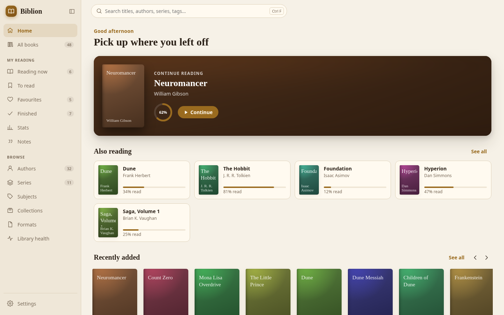
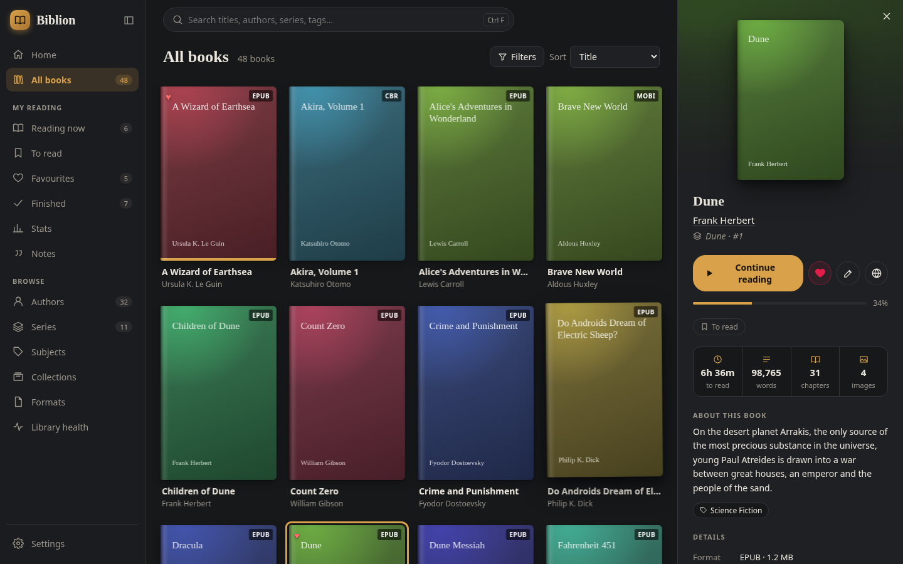
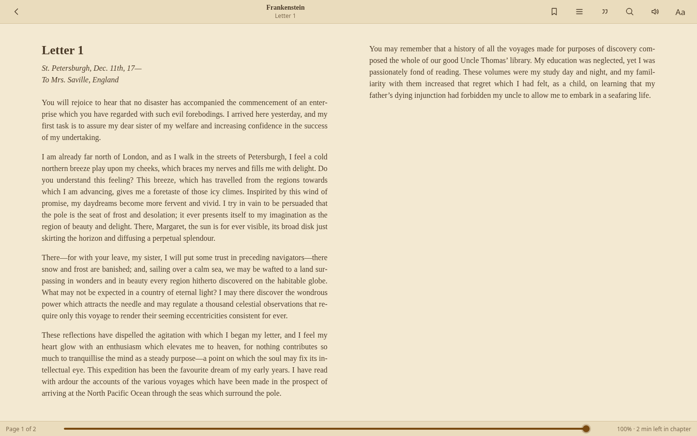
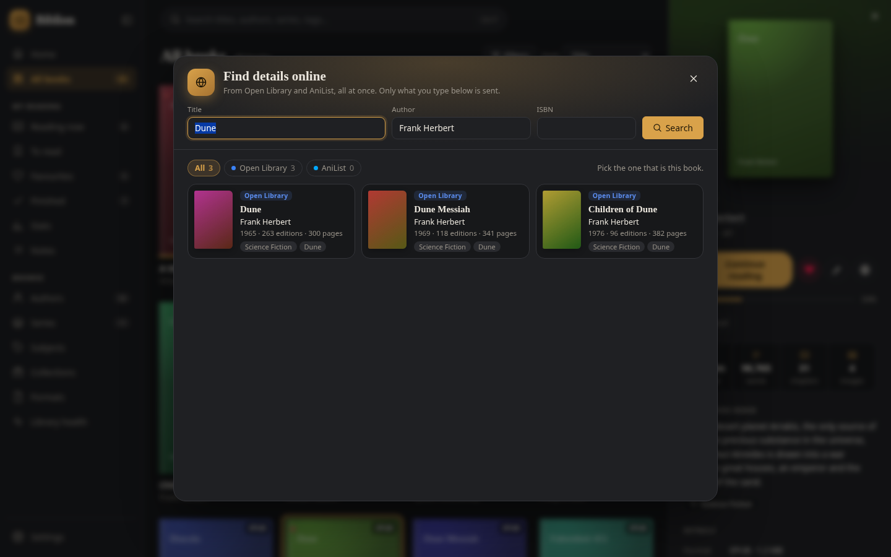
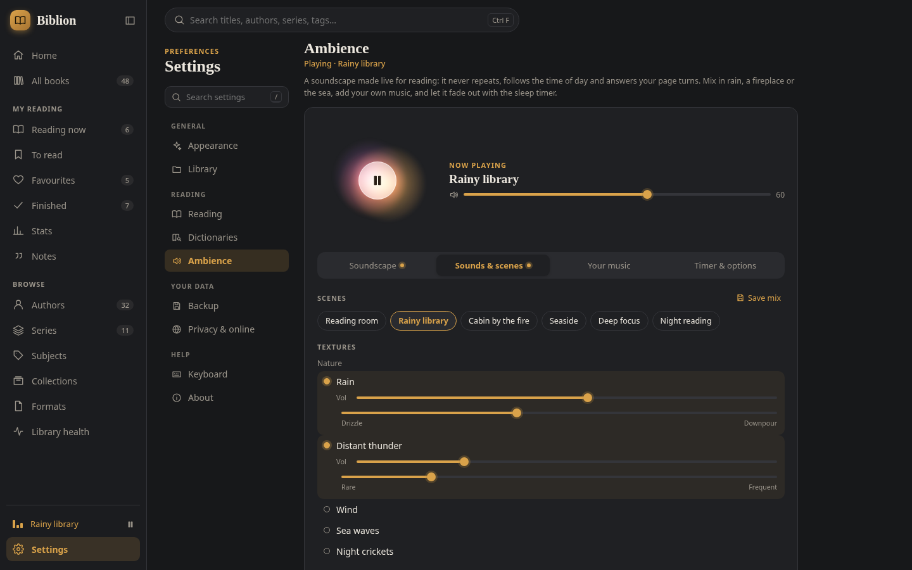
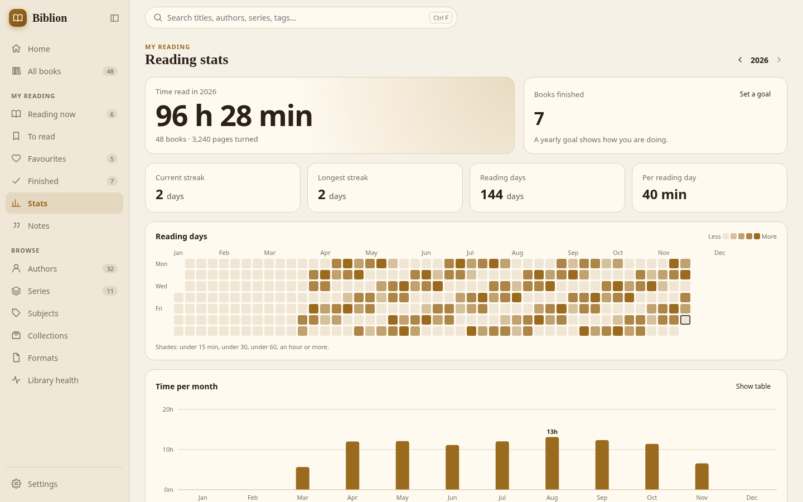

<p align="center">
  
</p>

<h1 align="center">Biblion</h1>

<p align="center">
  <b>Your library, on your computer.</b><br>
  A fast, private reader and library manager for your books and comics:<br>
  EPUB, MOBI, AZW3, PDF and CBZ/CBR, all in one place.
</p>

<p align="center">
  <a href="https://github.com/3Vynia/Biblion/releases">Download</a> ·
  <a href="#features">Features</a> ·
  <a href="#privacy">Privacy</a> ·
  <a href="#build-from-source">Build from source</a>
</p>



## Features

### A library that stays fast

Point Biblion at your folders and it reads every book once: titles, authors,
series, covers. After that, opening it takes a moment, rescans skip what has
not changed, and folders are watched, so new downloads show up on their own.
Browse by author, series, subject, format or collection, filter by what you
are reading or have finished, and search everything at once.



### Comfortable reading

- **EPUB, MOBI and AZW3** with day, sepia, night and console themes, your
  choice of font, size, spacing and margins, and one or two pages.
- **Highlights, notes and bookmarks**, all gathered in a Notes screen and
  exportable to Markdown.
- **A dictionary**: offline StarDict dictionaries, and Wiktionary if you allow it.
- **PDF** with zoom, contents, search and a night mode.
- **Comics and manga**: single pages, spreads, right-to-left, or a long strip.



### Book details, when you ask

Comics are named from their files ("Superman 012.cbr" is issue 12 of
*Superman*, "Magik v02.cbz" is volume 2 of *Magik*), and any book's details
can be edited by hand. If you
turn it on, Biblion also searches **Open Library** (books) and **AniList**
(manga, manhwa and light novels) at once, and lets you choose, field by field,
what to take: cover, description, subjects, dates.



### A reading ambience

A soundscape made live while you read: it never repeats, follows the time of
day and answers your page turns. Mix in rain, a fireplace or the sea, save your
own scenes, add your own music folder, and let it fade out with a sleep timer.



### Reading statistics

Time read per day and month, streaks, the books you finished and a yearly goal.



### And also

- **Library health**: duplicate files, books that could not be read, and
  missing files, with a safe way to tidy them up.
- **Backups**: one file with your progress, highlights, notes, collections,
  reading time and edited details, made daily on its own and restorable on
  another computer, even if your books moved.
- **Keyboard shortcuts** for everything: press <kbd>?</kbd> to see them.
- **Light and dark themes**, with a choice of accent colours.

## Privacy

Biblion works offline. It has no account and sends no usage data. Only two
things can reach the internet, and both stay off until you turn them on in
*Settings → Privacy & online*:

- looking up a word on Wiktionary (only that word is sent), and
- searching Open Library and AniList for a book you choose (only the title,
  author and ISBN you search for are sent).

## Download

Installers for **Windows** (`.exe`) and **Linux** (`.AppImage`, `.deb`, `.rpm`)
are on the [releases page](https://github.com/3Vynia/Biblion/releases).

> The Windows installer is not signed yet, so Windows may show a SmartScreen
> warning the first time: choose *More info → Run anyway*.

On Linux, the ambience sounds use GStreamer (`gst-plugins-base` and
`gst-plugins-good`, installed with the `.deb` and `.rpm` packages).

## Build from source

You need Rust, Node.js with pnpm, and the
[Tauri v2 system dependencies](https://v2.tauri.app/start/prerequisites/).

```bash
cd apps/desktop
pnpm install
pnpm tauri dev      # run in development
pnpm tauri build    # make the installers for this system
pnpm test           # unit tests
pnpm e2e            # end-to-end tests, against a mock backend (see dev/)
cargo test          # the Rust core and app
```

Set `BIBLION_DATA_DIR=/some/folder` to try Biblion with a separate library.
The screenshots above come from `SCREENSHOTS=1 pnpm exec playwright test e2e/screenshots.spec.ts`.

### Command line

The core also comes with a small command-line tool:

```bash
cargo build --release
B=./target/release/biblion
$B --data ~/biblion-data scan /path/to/books     # incremental
$B --data ~/biblion-data search "garcia marquez" # accent-insensitive
$B --data ~/biblion-data list --sort author --limit 50
$B --data ~/biblion-data apply-metadata details.json
```

## How it is built

A Rust core (`crates/biblion-core`) with SQLite and full-text search does the
heavy work: scanning, metadata, covers, search and statistics. The desktop app
(`apps/desktop`) is [Tauri 2](https://tauri.app) with a
[Svelte 5](https://svelte.dev) interface, and reads books with
[foliate-js](https://github.com/johnfactotum/foliate-js) and
[pdf.js](https://mozilla.github.io/pdf.js/). See
[ARCHITECTURE.md](ARCHITECTURE.md) for the details.

## License

No license yet: © 2026 Crystal, all rights reserved.
